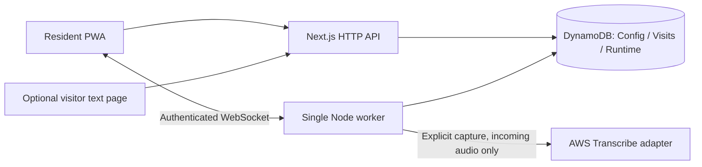

# CaptionDoor

**Understand your doorstep without relying on sound.**

CaptionDoor is a caption-first doorstep assistant for deaf and hard-of-hearing residents. A visible doorbell alert leads to a human claim, an explicitly started caption session, in-person handling and recorded closure. Visitor text and resident-approved replies provide an optional fallback.

The local demo runs without Ring or AWS credentials. It uses **real DynamoDB Local persistence**, simulated doorbell events and clearly labeled fixture captions. Real provider support is implemented, but incoming Ring audio and AWS-generated captions have **not** been verified.

[Quick start](#quick-start) · [Documentation](docs/README.md) · [Architecture](docs/architecture.md) · [Verification log](docs/test-results.md) · [Contributing](CONTRIBUTING.md)

## What you can try

- Visible alerts and one resident responsible for each visit, with explicit handoff.
- Captions that distinguish revisable partials from finalized segments.
- An optional isolated visitor thread with editable replies and deliberate send.
- Separate accepted, displayed and visitor-confirmed reply states.
- Independent consent controls, scoped access, retention and explicit deletion.
- A PWA with an honest offline state, keyboard controls and responsive layouts.

Replies reach the visitor web page. CaptionDoor does not speak through a Ring speaker, unlock doors, send automatic replies, identify faces or record audio/video. Captions can be wrong; a finalized segment is not verified truth. Closing a visit or reaching a timeout does not prove that someone left.

## Quick start

Install Node **24 LTS** (the exact version is in [.nvmrc](.nvmrc)), Corepack and Docker or OrbStack. Start the container runtime before setup. The workspace pins pnpm **12.14.0**.

```sh
git clone https://github.com/Xuefeng-Zhu/CaptionDoor.git
cd CaptionDoor
corepack pnpm install --frozen-lockfile
corepack pnpm setup:local
corepack pnpm dev
```

Open **[http://127.0.0.1:3410/onboarding](http://127.0.0.1:3410/onboarding)**, choose the local **Alex** identity and review the separate consent controls. In another tab, open **[/demo](http://127.0.0.1:3410/demo)** and select **A visitor rings**. Claim the visit with **I'll handle this**, then choose **Start Demo transcript**. Handle the fictional visit and explicitly record an outcome with **Close visit**.

Use a separate browser profile for **Sam**, the other resident. **Jordan** belongs to a second isolated household. For optional visitor text, open **[/door/front-demo](http://127.0.0.1:3410/door/front-demo)** in a private browser window. The resident must explicitly associate that thread; a QR scan or nearby timestamp establishes neither identity nor presence.

Setup starts only Compose project `captiondoor_local`, creates the three tables/indexes and seeds missing fictional records. Existing records are preserved. It also creates an ignored `.env` and a local fixture signing key when absent, without requesting cloud credentials. Keep `.env` private and restart web/worker after configuration changes.

| Service                   | Local address                                             |
| ------------------------- | --------------------------------------------------------- |
| Web and HTTP API          | `http://127.0.0.1:3410`                                   |
| Worker health / WebSocket | `http://127.0.0.1:3411/health` / `ws://127.0.0.1:3411/ws` |
| DynamoDB Local            | `http://127.0.0.1:8410`                                   |
| Optional HTTPS proxy      | `https://localhost:3443`                                  |

All host bindings are loopback. A phone's `127.0.0.1` points to the phone; testing the QR on another device needs a separately configured reachable HTTPS origin. See [local development](docs/local-development.md) for application containers, HTTPS, shutdown and troubleshooting.

## Verification

```sh
# TypeScript and unit tests; no provider credentials needed
corepack pnpm check

# Requires DynamoDB Local on 8410
corepack pnpm test:integration

# Also requires running web/worker and Chromium
corepack pnpm exec playwright install chromium
corepack pnpm test:e2e
corepack pnpm judge:replay

# Production compilation and packaging checks; no provider calls
corepack pnpm build
```

The replay runs a synthetic journey through actual local APIs, sockets and DynamoDB. It refuses provider/production modes and existing active demo visits, preserves failed attempts and writes a new evidence directory for each run. See [the replay guide](docs/judging-replay.md).

The [verification log](docs/test-results.md) records dated results, failures and skips. Unit tests may mock SDK/provider transport; integration tests use actual DynamoDB Local. Builds and synthesized templates do not establish cloud or device behavior. WCAG 2.2 AA is a design target; physical Safari/iOS and assistive-technology validation remain separate work.

## Current integration status

As of **2026-10-23**, recorded evidence distinguishes these layers:

| Layer                          | Recorded outcome                                                                                                                                                                                                       |
| ------------------------------ | ---------------------------------------------------------------------------------------------------------------------------------------------------------------------------------------------------------------------- |
| Local product journey          | Passed local integration, Chromium and replay checks on the dated revisions in the verification log.                                                                                                                   |
| Dedicated remote DynamoDB test | Three provider-test tables created and fictional seed setup completed; exact own-content and encrypted cleanup-copy absence verified after the attempt. Retained tables and budget metadata remain.                    |
| Official Ring Playground       | Device discovery reached during one authorized attempt. No incoming audio/video tracks were observed by the harness; the report was **SKIP**, coordinator **BLOCKED**. The exact media failure cause was not recorded. |
| AWS Transcribe                 | The attempt never started transcription; no PCM or AWS final captions were observed.                                                                                                                                   |
| Production and devices         | Live webhooks, Cognito/KMS, cloud dispatch, provider/device push and physical Safari/iOS remain unverified.                                                                                                            |

The remote test used a narrowly authorized exception and an operator-reviewed budget baseline. Its single authorized attempt is exhausted; zero paid-capture counters do not authorize a retry. The former Local paid-test scope was retired. See [the remote session checkpoint](docs/remote-provider-session.md) for the exact evidence and cleanup limits. Ordinary local demo setup remains credential-free.

The separate [remote-demo database plan](docs/remote-dynamodb-runbook.md) uses different tables and remains a proposal. It must not be confused with the executed provider-test stack. Public source availability does not mean the application is publicly deployed or submitted to a hackathon.

## Architecture and repository



DynamoDB is the **only persistent application database**. Authorization uses strong base-table reads and conditional transactions; GSIs discover work and visits. Runtime request/job paths do not scan tables. Local mode uses a due-index poller; the full cloud template additionally describes Streams → Lambda → SQS/DLQ dispatch, which is not deployed or validated by local tests.

| Path                                                                         | Responsibility                                         |
| ---------------------------------------------------------------------------- | ------------------------------------------------------ |
| [apps/web](apps/web)                                                         | Next.js resident PWA, visitor page and HTTP APIs       |
| [apps/worker](apps/worker)                                                   | Long-running WebSocket, capture and durable-job worker |
| [packages/domain](packages/domain), [packages/contracts](packages/contracts) | Browser-safe domain types, rules and wire contracts    |
| [packages/db](packages/db)                                                   | DynamoDB access, transactions, leases and deletion     |
| [packages/integrations](packages/integrations)                               | Ring, Transcribe, encryption and push adapters         |
| [infra](infra)                                                               | Isolated Compose configuration and CDK templates       |
| [scripts](scripts), [tests](tests), [fixtures](fixtures)                     | Setup, replay, guarded provider tools and verification |

Start with [architecture](docs/architecture.md), [data access patterns](docs/data-model.md), [HTTP contracts](docs/http-contract.md) and [security and privacy](docs/security-and-privacy.md). All guides are indexed in [docs/README.md](docs/README.md).

## License

CaptionDoor's new code is licensed under [MIT](LICENSE). Dependency notices are in [THIRD_PARTY_NOTICES.md](THIRD_PARTY_NOTICES.md). Ring and AWS integrations require their own authorized access and configuration; no credentials ship with this repository.
