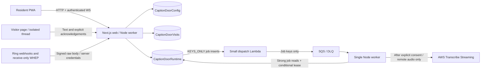

# CaptionDoor architecture

CaptionDoor helps a resident understand and respond to a doorstep event without relying on sound. It is communication assistance, not surveillance, identification, autonomous reception, an emergency service or a door lock controller. English and one selected door per household are the MVP scope. The local seed has two residents in one household and a second isolated household for denial tests.

## Runtime boundaries

Next.js App Router hosts the resident and visitor pages and HTTP boundary. The browser imports browser-safe types/contracts, never the DynamoDB or credential clients. A separate long-running Node process owns sockets, audio stream lifecycle and durable job delivery. DynamoDB is the only persistent application database. The only ephemeral state is socket registries, caption partials and bounded live audio buffers. See [data-model.md](data-model.md) for the authoritative keys/access patterns.

The local transport polls the due-work GSI, strongly rechecks and conditionally leases jobs, and executes the same durable work handlers used by a cloud queue wake-up. It is a substitute for cloud dispatch transport; it does not validate Streams, Lambda or SQS. Scheduled work and missed dispatch recover from the due index. A completed SQS receipt is never the sole copy of a pending job. The MVP uses exactly one worker: SQS competing consumers do not broadcast to sockets on other replicas. Shared fan-out must be designed and verified before scaling workers.

## Complete communication journey

1. A verified Ring button event or explicitly labeled local event atomically creates/returns the selected door's active visit and alert outbox job.
2. A resident explicitly claims with the current version. One conditional transaction wins. Claiming never sends a reply.
3. Captions, when available, are separate from visitor text and resident replies. Partial text can revise; a finalized caption is not verified truth.
4. Each guest browser receives its own short-lived opaque thread. A resident explicitly associates it with the visit. Timing and the public QR code do not establish identity or presence.
5. The handler edits a preset or writes a reply and explicitly selects **Send to visitor page**. Acknowledgement moves from ACCEPTED to visibly DISPLAYED to an explicit CONFIRMED action. Socket delivery alone does not imply either of the latter states.
6. The resident closes with a recorded outcome. Timeout never proves that a person left. A closed session identifies an interaction, not a person.

A pending handoff leaves responsibility with the existing handler until an authorized acceptance/takeover transaction fences old audio leases and stale replies. A lost socket stops capture but does not unclaim the visit. Text remains usable when media is absent, interrupted, expired or unsupported. A visitor without a phone can supply incoming speech captions if Ring audio is available, but cannot receive web replies; CaptionDoor never speaks through the Ring speaker.

## Integration provenance and failure

Event source, media source and transcript source are independent. `RING_MODE=demo` is a local CaptionDoor simulator, not the official Ring Playground. `TRANSCRIBE_MODE=fixture` is labeled **Demo transcript**. Missing credentials or live failure never trigger a silent demo fallback. Real-device availability, partner access, encryption restrictions and browser/WebRTC support remain external gates; see [integration-contracts.md](integration-contracts.md) and [compatibility-matrix.md](compatibility-matrix.md).

Media is optional receive-only WHEP, explicitly selected after authorization. Ring credentials and validated signaling stay on the server; app media IDs are opaque. No microphone is requested. The audio graph selects an incoming remote track, performs actual mono resampling to 16 kHz, emits signed PCM16LE in approximately 100 ms chunks and discards buffered audio on interruption. No audio/video recording is stored by CaptionDoor.

## Isolated development and host configuration

`compose.yaml` has project name `captiondoor_local`, an isolated DynamoDB volume and loopback ports 8410/3410/3411/3443. It never connects to a shared DynamoDB instance. DynamoDB Local is pinned to 3.3.2, the current 3.x maintenance release in AWS's [release history](https://docs.aws.amazon.com/amazondynamodb/latest/developerguide/DynamoDBLocalHistory.html) checked 2026-10-22. Telemetry is disabled. Node and Caddy image tags and pnpm package versions are pinned.

The `app` Compose profile runs both application processes locally. The optional `https` profile uses Caddy's private local CA; the repository never installs that CA into system trust. Host mode has independent configuration in `infra/compose.aws.yaml`, production image targets, real AWS tables and Cognito; it must never be merged with demo Compose. Only the reverse proxy publishes host ports. `infra/cdk` synthesizes on-demand single-Region tables, KEYS_ONLY Runtime Streams, a filtered dispatch Lambda, SQS/DLQ, KMS credential key, least-privilege host profile and Cognito. It creates no EC2 host, DNS or certificate and performs no deployment.

The default `.invalid` cloud origin is deliberate. Actual HTTPS callbacks, approved partner access, client secrets and explicit deployment authorization are prerequisites. CDK synth proves template generation, not deployed transport or IAM behavior. DynamoDB transaction IAM grants use item-level permissions as required by [AWS](https://docs.aws.amazon.com/amazondynamodb/latest/developerguide/transaction-apis-iam.html); runtime IAM does not grant Scan or table administration.

## Costs, deletion and shutdown

No billable resources are deployed by local scripts. A future authorized cloud deployment incurs host, DynamoDB, KMS, SQS/Lambda, Cognito and Transcribe charges based on usage; no price estimate has been measured here. Raw media is not recorded. Logs must contain IDs/timing/transitions and sanitized error categories only.

To stop only this local project, use `docker compose -p captiondoor_local --profile app --profile https down` from this checkout. This preserves the named local database volume. `pnpm demo:reset` is destructive only to CaptionDoor's explicitly validated local tables; it refuses cloud endpoints. Do not use global Docker prune/stop commands.

Cloud tables, the KMS key, queues and identities are retained/deletion-protected in CDK so stack removal cannot silently erase resident data. Future cleanup requires explicit authorized content deletion and verification, draining jobs/DLQ, disabling integrations and access, then separately reviewing retained tables/backups, Cognito and the KMS scheduled-deletion window. Retention expiry removes application access before delayed TTL cleanup; explicit deletion jobs remove application content copies. Provider, log and backup retention cannot be represented as instant physical erasure.
